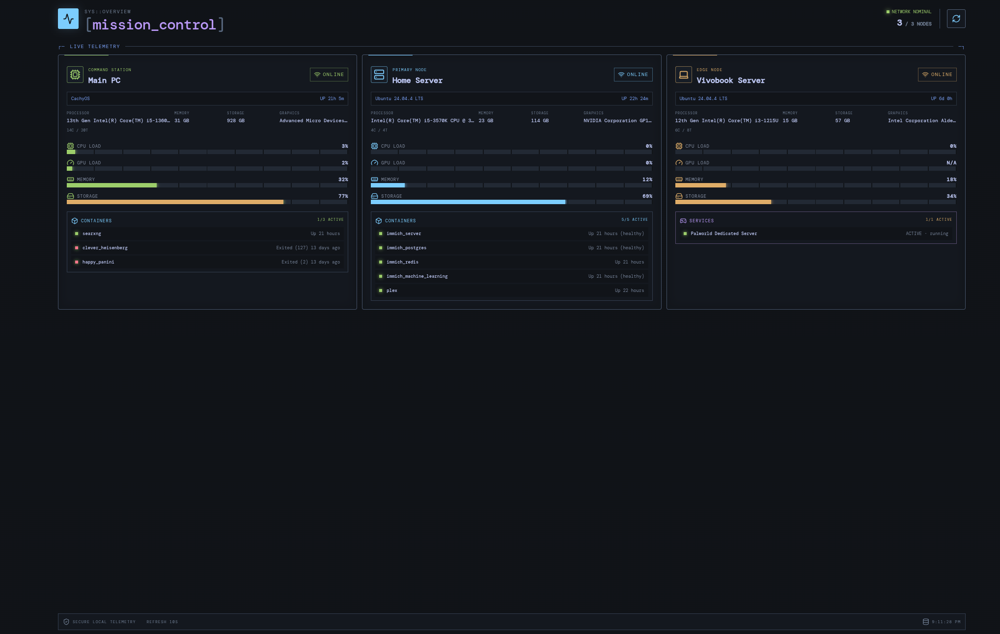

# Mission Control

Mission Control is a self-hosted dashboard, styled after btop, that shows the state of several machines on one page. Each card shows a machine's hardware, CPU, GPU, memory and disk usage, uptime, Docker containers, and chosen systemd services.

It is meant for a trusted LAN or a private overlay network such as Tailscale. It needs no cloud account or external database.

## Features

- A device grid that fills the screen width
- Meters for CPU, GPU, VRAM, memory, root disk, and temperature
- Hardware details for CPU, GPU, VRAM, memory, storage, operating system, and uptime
- Network receive and transmit rates, and disk read and write throughput
- A drive list per device with mount point, usage, and SMART health when `smartctl` is available
- AMD GPU usage and VRAM from Linux sysfs, and NVIDIA GPU usage and VRAM from `nvidia-smi`
- Docker container state, uptime, and health status
- systemd service monitoring for the units you list, such as game servers
- UP, DOWN, DEGRADED, and STALE status per device, with last-checked times
- Old readings stay on screen during an outage, labeled as outdated
- A manual refresh button
- A Python telemetry agent that uses only the standard library
- A Node.js development server and a standalone Python production server
- A configurable bind address, `MISSION_CONTROL_HOST`, for private network interfaces
- Remote access through Tailscale IPs or MagicDNS

## Screenshots



## Architecture

```text
Browser
  └── Dashboard host (:8080 production or :5173 development)
        ├── Main PC telemetry agent (:4242 or :4243)
        ├── Home Server telemetry agent (:4242)
        └── Additional telemetry agents (:4242)
              ├── /proc and /sys hardware metrics
              ├── Docker CLI
              └── systemctl
```

Each monitored Linux machine runs `agent/telemetry_agent.py`. The dashboard host reads a private device list, polls `/api/agent/stats` on each endpoint in the background, and serves the combined result to the React frontend. Keep agent endpoints reachable only from a trusted LAN, VPN, or tailnet.

## Requirements

### Dashboard development

- Node.js 22.13 or newer. CI uses Node 22.
- npm

### Production dashboard host

- Python 3.9 or newer
- A Linux user with a working systemd user session

### Telemetry agents

- Linux with Python 3.9 or newer
- `systemctl` for service monitoring
- The Docker CLI and permission to use the Docker socket, for container monitoring
- Optional: `lspci` to identify GPUs
- Optional: `nvidia-smi` for NVIDIA GPU usage
- Optional: `smartctl` from smartmontools for drive health

The Node server can collect local telemetry on Windows through `systeminformation`. The Python agent and the systemd units are Linux only.

## Development installation

```bash
git clone https://github.com/SaiAnumula/homelab-mission-control.git
cd homelab-mission-control
npm ci
cp devices.example.json devices.json
npm run dev
```

Open `http://localhost:5173`. Vite serves the frontend and proxies `/api` to the Node server on port 4242. The example `devices.json` uses synthetic demo data, so development contacts no agents and collects no host telemetry. To monitor real machines, set an endpoint to `local` or to an agent URL.

Build the frontend with:

```bash
npm run build
```

## Tests and checks

None of these commands contact a real machine.

```bash
npm ci
npm test                       # Python unittest + mocked Node helper tests
npm run lint                   # ESLint; warnings fail
npm run typecheck              # TypeScript checks frontend JavaScript/JSX
npm run build                  # Production Vite assets
python3 -W error -m unittest discover -s tests
python3 -W error -m compileall -q agent deploy tests
```

The Python tests block sockets, DNS lookups, port binding, and subprocesses, even when you run a single test module. Command, service, and network checks use mocks only. The suite starts no server and runs no Docker, SSH, or systemctl commands. The Node tests import helper modules with stub collectors. They never import `server.js` or start host monitoring.

## Refresh and status

### Server checks

The Node API and the Python dashboard server both check devices in background workers that every browser client shares. Each device follows this schedule:

| State | Meaning | Next check |
| --- | --- | --- |
| UP | The last telemetry request succeeded | 10 seconds after the check finishes |
| STALE | Telemetry is failing | Every second for the first 10 seconds of the failure, then every 15 seconds |
| DOWN | Health checks have failed for 10 seconds | Every 15 seconds |

While a device is failing, each check first calls its `/api/health` endpoint with a one-second timeout. A successful health check triggers a telemetry request right away, and fresh telemetry returns the device to UP. A device that answers health checks stays STALE and never becomes DOWN, however long its telemetry fails. STALE and DOWN cards keep the last good readings and label them as outdated. A device also shows STALE while its first check runs.

Checks for one device never overlap. Each server runs at most eight checks at once, so a large installation can delay checks. Node's `local` and `demo` devices have no health endpoint, so the server retries their telemetry directly.

A reachable device shows DEGRADED instead of UP when a monitored service is inactive, a container is unhealthy or starting, or a drive reports warning or failing.

### Browser polling

The browser polls `/api/devices`, which returns the server's latest snapshot without waiting on any agent.

- When every device is healthy, the next request starts 10 seconds after the previous one finishes.
- When a device turns STALE or a request fails, the browser polls every second for 15 seconds. It then returns to every 10 seconds, even if the problem continues.
- A DOWN device never triggers fast polling, because the server only rechecks it every 15 seconds.
- Requests time out after 6 seconds. Clicking refresh during a request reuses that request.
- Switching back to the tab refreshes right away. Hidden tabs keep polling, subject to the browser's timer throttling.
- A failed request leaves the previous snapshot on screen with STALE labels.
- The browser also marks a device STALE when its readings are more than 35 seconds old.
- The footer shows the current poll interval and the time of the latest snapshot.

### Caching, limits, and timestamps

The Python agent and Node's local collector cache each collection for 10 seconds and share it across requests. The agent caches a failed collection for 10 seconds too, so repeated requests don't re-run the collection on an unhealthy host. The servers time each check from when the previous one finished, which means a healthy device's next check arrives after the cache expires and gets fresh data.

Telemetry requests from either server time out after 4 seconds. The Python server also limits responses to 1 MiB. Agent responses cannot override a device's configured identity, and API responses never include endpoints or credentials.

Each device in the API response carries three timestamps:

- `collectedAt` is when the Python agent built the snapshot.
- `checkedAt` is when the dashboard last finished a check.
- `lastGoodAt` appears during an outage and is when the last successful check happened.

Each agent subprocess has its own timeout, but a full collection has no overall deadline. On slow hardware the first collection can take longer than the 4-second request timeout.

## Device configuration

`devices.json` holds the local runtime configuration, and Git ignores it. Start from the example:

```bash
cp devices.example.json devices.json
```

Each device supports these fields:

| Field | Purpose |
| --- | --- |
| `id` | Stable unique identifier |
| `name` | Display name |
| `label` | Small role label shown above the name |
| `type` | Icon type: `pc`, `server`, or `laptop` |
| `endpoint` | `demo` for synthetic Node data, `local` for host collection, or an HTTP(S) agent URL |
| `accent` | Card color: `green`, `cyan`, or `amber` |

Example remote endpoint:

```json
{
  "id": "nas",
  "name": "Storage Server",
  "label": "STORAGE NODE",
  "type": "server",
  "endpoint": "http://storage.example:4242",
  "accent": "cyan"
}
```

The `.example` hostnames are reserved documentation names. Put real hostnames only in your ignored runtime configuration. The Python production server supports `local` and HTTP(S) endpoints. `demo` works only in the Node development server.

Each `id` must be unique, `id` and `name` must be nonempty strings, and a configuration can list at most 64 devices. The API returns an error for an invalid configuration instead of showing an empty dashboard.

To load a different configuration file in Node, set `MISSION_CONTROL_DEVICES=/path/to/devices.json`.

## Telemetry agent setup

Copy these files to the monitored Linux machine:

- `agent/telemetry_agent.py` to `~/.local/share/mission-control/telemetry_agent.py`
- `agent/mission-control-agent.service` to `~/.config/systemd/user/mission-control-agent.service`

Then enable the service:

```bash
chmod 755 ~/.local/share/mission-control/telemetry_agent.py
systemctl --user daemon-reload
systemctl --user enable --now mission-control-agent.service
sudo loginctl enable-linger "$USER"
```

The agent listens on `0.0.0.0:4242` by default. To change the port, or to bind only to localhost or a Tailscale address, add these lines to the unit:

```ini
Environment=MISSION_CONTROL_PORT=4243
Environment=MISSION_CONTROL_HOST=127.0.0.1
```

Some PCI IDs cover several similar GPU models. If the agent shows the wrong model, set the exact name:

```ini
Environment="MISSION_CONTROL_GPU_NAME=Radeon RX 9070"
```

Check that the agent responds:

```bash
curl http://127.0.0.1:4242/api/agent/stats
```

## Production dashboard service

Build the frontend, then copy these to `~/.local/share/mission-control-dashboard/` on the always-on host:

- `dist/`
- `deploy/dashboard_server.py`
- A private `devices.json`, copied from `deploy/devices.server.example.json`

Copy `deploy/mission-control-dashboard.service` to `~/.config/systemd/user/`, then run:

```bash
systemctl --user daemon-reload
systemctl --user enable --now mission-control-dashboard.service
sudo loginctl enable-linger "$USER"
```

The production dashboard listens on `0.0.0.0:8080`. Set `MISSION_CONTROL_DASHBOARD_PORT` to change the port. Set `MISSION_CONTROL_DASHBOARD_HOST` or `MISSION_CONTROL_HOST` to bind to one IP. Set `MISSION_CONTROL_DEVICES` to load a configuration from outside the application directory.

## Docker monitoring

The agent runs `docker ps -a` as its service user. If that user can't reach the Docker socket, add it to the `docker` group:

```bash
sudo usermod -aG docker "$USER"
```

Log out and back in, or restart the user manager, to apply the new group. Membership in the `docker` group is equivalent to root access, so grant it only to trusted users. On a machine without Docker, the container list is empty.

## Systemd service monitoring

The agent checks the units listed in `MISSION_CONTROL_SERVICES` and skips any that aren't installed. The default is `palworld.service`. To monitor other units, list them in the agent unit, separated by commas:

```ini
Environment=MISSION_CONTROL_SERVICES=palworld.service,minecraft.service
```

After editing the unit, reload and restart the agent:

```bash
systemctl --user daemon-reload
systemctl --user restart mission-control-agent.service
```

Mission Control only reads service state. It never starts, stops, or restarts a service.

## Storage and drive health

The main storage meter shows the physical disk that holds `/`. Click the storage row on a card to list the device's other physical drives. The list skips virtual devices such as loop and zram disks. It shows unmounted physical disks with usage marked unavailable.

Drive sizes use decimal units, so a 2 TB drive shows as 2 TB. Memory capacity is rounded to a common installed-RAM size, while the usage meter uses the usable memory that Linux reports.

Drive inventory, capacity, and usage work without SMART. If `smartctl` is installed and the agent user can read the drives, each drive shows its overall SMART result. Otherwise it shows `SMART N/A`.

The agent checks each drive's SMART health once every 10 minutes and reuses that result in between. A drive that starts failing can take up to 10 minutes to show it. To change the interval, set `MISSION_CONTROL_SMART_INTERVAL` in the agent unit, in seconds. The agent runs `smartctl` with `-n standby`, so it never spins up a sleeping drive. A sleeping drive keeps its last result, or shows `SMART N/A` if it was asleep since the agent started.

The agent runs at most eight SMART probes at once, each with a 4-second timeout. With many or slow drives, a collection that probes every drive can still exceed the dashboard's timeout. Later requests use the cached result. A drive shows warning or failing only when the drive itself reports it. A result the agent can't read shows `SMART N/A`.

Install smartmontools with the host's package manager:

```bash
# Debian or Ubuntu
sudo apt install smartmontools

# Arch Linux
sudo pacman -S smartmontools
```

Then check access as the user that runs the agent:

```bash
smartctl -n standby -H -j /dev/sda
```

Some systems allow drive diagnostics only for root, even with `smartctl` installed. Don't give the agent unrestricted sudo just for SMART data. If you need health reporting, use narrow device permissions or a sudo rule an administrator has reviewed. Mission Control treats missing health data as normal.

On a dedicated Linux host, the agent can call `smartctl` through non-interactive sudo:

```ini
Environment=MISSION_CONTROL_SMARTCTL_SUDO=1
```

This setting grants nothing by itself. An administrator must also allow the exact read-only command for each monitored drive. For example, `/etc/sudoers.d/mission-control-smart` could contain:

```sudoers
mission-control-user ALL=(root) NOPASSWD: /usr/sbin/smartctl -n standby\,3 -H -j /dev/sda, /usr/sbin/smartctl -n standby\,3 -H -j /dev/sdb
```

Sudo compares the arguments exactly, and the comma must be escaped as `\,`. A rule written for an older agent that ran `smartctl -H -j` no longer matches, and those drives show `SMART N/A` until you update it. Change the username and device paths for the host, and validate the file with `visudo`. Don't use wildcards, and don't grant general `smartctl`, shell, or sudo access.

## Tailscale usage

Install Tailscale on the dashboard host, the monitored machines, and the devices you browse from. Use each machine's Tailscale address or MagicDNS name as its endpoint. Then open the dashboard from any device on the tailnet:

```text
http://dashboard.example:8080
```

If UFW is enabled, allow the ports only on the Tailscale interface:

```bash
sudo ufw allow in on tailscale0 to any port 8080 proto tcp
sudo ufw allow in on tailscale0 to any port 4242 proto tcp
```

Don't forward these ports on your router. Use Tailscale grants or ACLs to limit which tailnet identities can reach the dashboard and agent ports.

## Security considerations

- The dashboard and the agent have no authentication of their own.
- Bind them only to trusted networks, preferably a tailnet with access controls.
- Never expose ports 4242, 4243, or 8080 to the public internet.
- Keep real device configuration out of Git. The repository ignores both runtime JSON files.
- Don't put auth keys, API tokens, passwords, or reusable Tailscale credentials in device configuration.
- Telemetry reveals host hardware, usage, service names, and container names. Treat it as private data.
- Docker group membership gives broad control of the host. Use a dedicated, trusted service user when possible.
- Check example configuration and screenshots for real identifiers before publishing changes.

## Tech stack

- React 19
- Vite 8
- Express 5 and `systeminformation` for the Node development server and local telemetry
- Python standard library for the production server and the Linux agent
- Lucide React icons
- systemd user services
- Tailscale for private networking

## License

Mission Control is available under the [MIT License](LICENSE).
